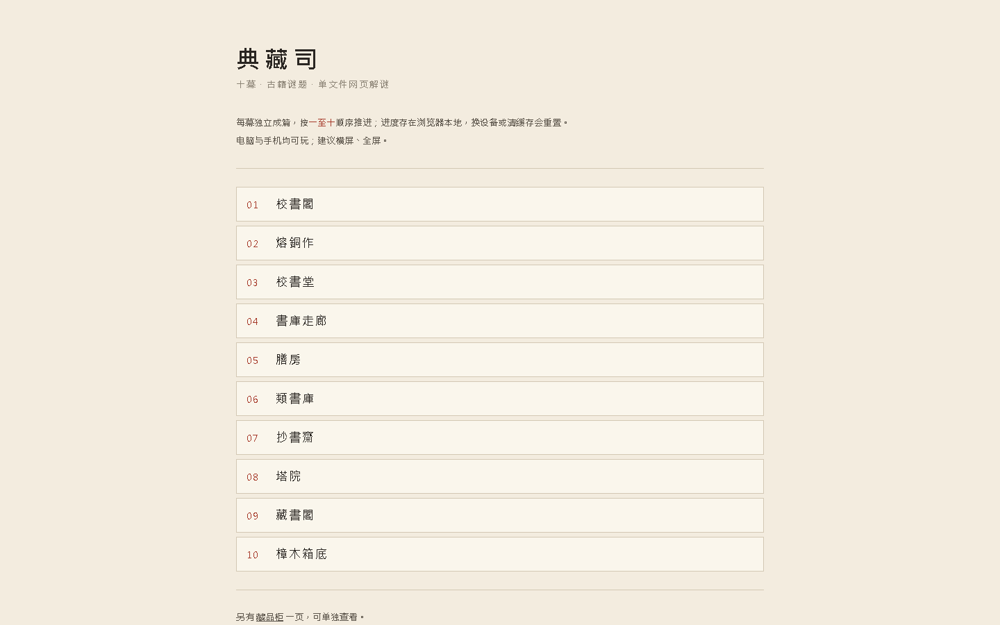

> **2026-10-19 更新：已扩为十幕。**
> 访问首页即为十幕目录；旧版落地页保留在 `about.html`。
> 十幕文件名为 `第一幕.html` … `第十幕.html`，另有 `view-cabinet.html`（藏品柜）。
# 《典藏司》· 古籍解谜文游（九卷）

你是新入**典藏司**的校书郎。城南旧藏书楼里，收着天下散佚的古书。
入职第一夜，老掌书递来一盏灯、一把镊子，只说了一句：**书不会说话。但它藏得住事。**

案上三卷、樟木箱里六卷，都被蠹虫蛀掉了最要紧的地方——账目的对不上、卦象的六画、验尸的破绽、
造一张竹纸的先后……每一处空缺，都是一道**从古籍原文里长出来的谜题**。
你要做的不是猜，而是读懂它。每解开一卷，就补全一页断简，收进你的藏书阁。

> 别人做古籍是"贴皮"，这一作让玩家**在解题的过程里，真的读懂了一段原文**。

- **游戏类型**：单机 · 解谜推理 · 文化科普（文游）
- **技术形态**：单文件 HTML（内嵌 JS/CSS），离线运行，零依赖、零外部素材
- **目标平台**：任意现代浏览器（双击即玩）；手机自适应
- **单局时长**：约 15–25 分钟（九卷通关）

---

## 如何运行

1. 打开 `index.html`（双击，或用浏览器打开）。
2. 离线可玩，无需安装、无需联网。
3. 手机浏览器同样可玩（已按 390px 宽度验证）。

> 若双击被编辑器打开：右键 → 打开方式 → 选择浏览器。

---

## 玩法循环

**展残页 → 读原文 → 解谜 → 补全断简 → 得书页卡 → 下一卷。**

1. **展残页**：每关的残页起先是蒙着的，先点开细看——虫蛀掉的字，就是谜题所在。
2. **解谜**：五种交互轮换——数字填写、单选判断、点按拼爻、左右配对、工序排序。
3. **问沈砚**：卡住时逐级给出「原文的读法」作提示，不直接报答案，不设死路。
4. **补全 · 收藏**：答对后残页补全，得一页「书页卡」，收进藏书阁。
5. **三幕推进**：入门三卷 → 樟木箱六卷 → 结局章。

> 谜题答案不作剧透。卡关请用游戏内「问沈砚」，那本身就是古籍的读法。

---

## 九卷一览

| 卷一 | 卷二 | 卷三 | 卷四 | 卷五 |
|---|---|---|---|---|
| 孙子算经 | 洗冤集录 | 棠阴比事 | 考工记 | 营造法式 |
| 卷六 | 卷七 | 卷八 | 卷九 | |
| 九章算术 | 天工开物 | 周易 | 山海经 | |

对应谜题类型：数字输入 · 单选判断 · 单选判断 · 左右配对 · 单选判断 ·
数字输入 · 工序排序 · 点按拼爻 · 左右配对。

> 卷一~卷三为「案上三卷」（入门），卷四~卷九为「樟木箱六卷」。
> 排序刻意让能力轮换（算 · 验 · 判 · 校 · 猜），并把最"知识问答"的《周易》《山海经》
> 沉到第 8、9 位，当世界观放大器用。

---

## 角色

| 人物 | 定位 | 记忆点 |
|---|---|---|
| **你**（校书郎） | 玩家本人，第二人称叙事 | 从生手到读懂古籍 |
| **老掌书 · 沈砚** | 引导者 / 师父 | 寡言，「书不会说话。但它藏得住事」 |
| **阿棠** | 同僚 / 调剂 | 早入司两年的抄书女工，爱插话、会背错诗 |
| 蠹鱼 | 象征性对手 | 不拟人化——它是时间本身 |

---

## 素材与授权

- **古籍原文**：取自公有领域文本（殆知阁古代文献 <https://github.com/frankslin/daizhigev20>），
  **原文一律原样引用**，白话解释、谜题、剧情、人物全部自撰。
- **美术**：界面为程序生成的宣纸水墨风格（纸色渐变 + 朱砂印章 + 纸纹与烛火呼吸），`cover.png` 由脚本绘制，
  **不含任何 AI 绘制的图片**，零外部素材、零采购。
- **音效**：翻卷 / 落笔 / 答对 / 答错 / 翻纸五个音，全部由 **WebAudio 现场合成**——
  零音频文件、零外部链接（发布校验禁止外链，因此不用任何 mp3/wav）。
- **开源许可**：MIT + 非商业补充说明（见 `LICENSE`）；如需商业使用请联系作者。

---

## 文件清单

| 文件 | 说明 |
|---|---|
| `index.html` | **主游戏源码**（单文件，双击浏览器即玩） |
| `cover.png` | 封面图（程序绘制，900×1200） |
| `LICENSE` | MIT + 非商业补充说明 |
| `README.md` | 本说明 |
| `lumi-publish/` | 谜页集发布工程（`npm run build` → `dist/index.html`；`npm run validate` 做发布前校验） |

---

## 验收对照

- [x] 游戏能正常启动（双击 `index.html` 即可）
- [x] 九卷全部可解，五种谜题交互均可完成
- [x] 每关有逐级提示，不卡关、不设死路
- [x] 三幕叙事完整，含樟木箱幕间与结局章
- [x] 藏书阁按进度收录，九卷修全可归位
- [x] 残页需先「展开」再作答；已修过的卷复看时直接展开
- [x] 进度自动存档（localStorage），关掉网页再打开可续修
- [x] 对白逐字显示；系统开启「减少动效」时自动快放，并关闭装饰性动画
- [x] 音效可一键静音，设置本地记住
- [x] 手机自适应（390px 宽度无横向溢出）
- [x] 所有古籍引文均与公有领域原文逐句核对

---

*—— 典藏司 · 校书郎*